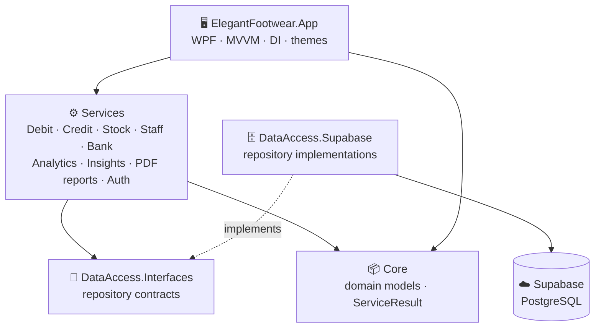

<!-- Ledgerio · README by Usama Shahid (fewgets) -->

  
  
  
  
  
  

---
> 💼 **Project showcase.** Ledgerio is a production app built for a wholesale footwear business, so the
> source code is private. This page explains what it does and how it is built.

## 📌 Overview

**Ledgerio** is a native **Windows point-of-sale and business-ledger application** for wholesale
and distribution businesses. It replaces paper registers and spreadsheets with one fast desktop app
that manages **customers (debit parties), suppliers (credit parties), stock, bank accounts and staff
salaries**, then turns all of that data into **daily insights, analytics and printable PDF reports**.

It started as a Python (CustomTkinter) app and was **rebuilt from the ground up in C# / WPF on .NET 10**
for a faster, fully native feel, with **full functional parity** checked against the original.

---

## ✨ Features

### 🧾 Sales and Customer Ledger (Debit)
- Multi-item **orders** with live price preview, stock deduction and per-item recovery if one fails
- Customer accounts with **city → province** mapping and Active / Defaulted status
- Running balances, payments (cash, online, slip, cheque), returns and discounts
- Reports: **single party, city-wise, province-wise, and old / overdue accounts** (overdue rows highlighted)

### 🏭 Supplier Ledger (Credit)
- Supplier accounts and purchase entries with automatic debit/credit detection
- Latest balances, single-party and whole-ledger PDF reports

### 📦 Stock Management
- Add, update, edit and delete articles, with **low-stock highlighting**
- Full **stock movement log**: daily *added vs. sold* activity report
- Configurable stock fields and printable stock sheets

### 🏦 Banks and 👥 Staff
- Bank accounts with transaction history
- Staff directory, monthly salaries, bonuses, deductions and **advances to recover**
- One-click **PDF salary slips**

### 📊 Smart Dashboard and Analytics
- **"Today" strip:** sales today vs. yesterday, cash vs. credit sales, payments received, returns, discounts
- **Automatic insight lines** in plain language (good news ✅ or needs attention ⚠️)
- **Top debtors** list showing who owes most and how long since their last entry
- Analytics by any date range with automatic daily / weekly / monthly grouping, **best sellers** and period-over-period change

### 🎨 Experience
- **12 colour themes** (Sage, Teal, Navy, Leather, Graphite, Obsidian, Emerald, Luxe…), light and dark
- **Customisable keyboard shortcuts** (`Ctrl + key`) for every main action
- Searchable drop-downs, toast notifications, skeleton loaders, smooth scrolling
- PDF reports on the business **letterhead**, saved and auto-numbered automatically

### 🔐 Security
- **Login lockout:** 5 failed attempts lock the account for 1 hour (enforced on the server)
- Hashed passwords and role-based access

---

## 🏗️ Architecture

A clean, layered **MVVM** solution. Business rules have **zero dependency** on the UI or the database,
so either can be swapped without touching the logic.

| Project | Responsibility |
|---|---|
| `Core` | Domain models (parties, transactions, stock, staff, banks) and result types |
| `DataAccess.Interfaces` | Repository contracts |
| `DataAccess.Supabase` | Implementations using the official Supabase C# client |
| `Services` | 100% of the business rules, analytics, insights and PDF generation |
| `App` | WPF views and view models, navigation, theming, dependency injection |
| `Tests` | xUnit + Moq unit tests |

---

## 📈 By the Numbers

| | |
|---|---|
| 🖥️ Screens | **30+** (dashboard, 10 debit, 7 credit, 6 stock, banks, staff, analytics, reports, settings) |
| 🧪 Unit tests | **110** xUnit tests covering the highest-risk logic |
| 🎨 Themes | **12** |
| 📄 PDF report types | **10+** ledgers, stock sheets and salary slips |

**Tested logic includes:** stock replace-vs-add semantics, stock-movement logging, the
quantity/price vs. manual-amount conflict rule, login lockout, analytics grouping, dashboard insights,
salary calculations, PDF generation and keyboard-shortcut conflicts.

---

## 🧰 Tech Stack

| Layer | Technology |
|---|---|
| Language / Runtime | C#, .NET 10 |
| UI | WPF, MVVM, Microsoft.Extensions.DependencyInjection / Hosting |
| Database | Supabase (PostgreSQL) via `supabase-csharp` |
| PDF | PdfSharpCore, SixLabors.ImageSharp |
| Testing | xUnit, Moq |
| Previous version | Python, CustomTkinter, ReportLab |

---

## 📂 Source Code

Ledgerio is a client product, so the source code is private.
**Want a similar system for your business, or a demo?** Get in touch below.

---

## 📜 License

© 2026 Usama Shahid. All rights reserved. This repository is a project showcase; the source code is private.

---

## 🤝 Let's Work Together

**Have an idea, a freelance project, or want to collaborate on something in AI?**
I'm always open to collaborations, freelance work and full-time opportunities.

  

⭐ **If you like this project, please give it a star. It really helps!** ⭐

 

<h3>"Run your business on numbers, not guesswork."</h3>

